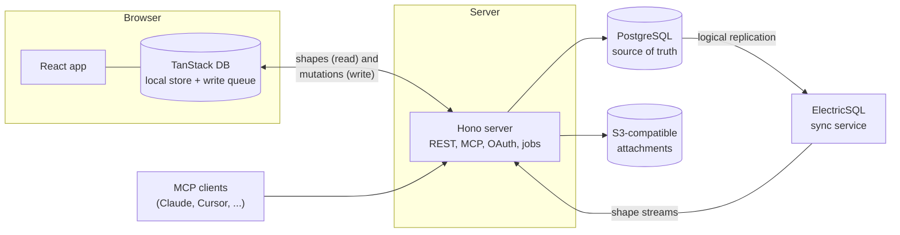

<p align="center">
  <picture>
    <source media="(prefers-color-scheme: dark)" srcset="apps/web/public/brand/logo-dark.svg">
    
  </picture>
</p>

<h1 align="center">Torch</h1>

<p align="center">
  <strong>An open-source issue tracker with work handoffs built in, and AI in the loop through MCP.</strong><br>
  Fast like Linear. Yours to run, brand and fork.
</p>

<p align="center">
  <a href="https://github.com/dotzerolab/torch/actions/workflows/ci.yml"></a>
  <a href="LICENSE"></a>
  
</p>

<p align="center">
  <a href="#why-torch">Why</a> ·
  <a href="#what-v1-will-do">Features</a> ·
  <a href="#architecture">Architecture</a> ·
  <a href="#development">Quick start</a> ·
  <a href="#roadmap">Roadmap</a> ·
  <a href="#contributing">Contributing</a> ·
  <a href="#license">License</a>
</p>

> [!WARNING]
> **Torch is pre-v1 and not ready for use.** The foundations are being built; there is nothing to install or deploy
> yet, and nothing is stable. The code is public so you can follow along, read the design and help. Watch the
> repository, or read the [roadmap](#roadmap), to know when v1 is near.

## What is Torch?

Torch is an issue tracker that works like Linear (issues, cycles, projects, triage, a keyboard-first UI that never
waits for the network) with two things most trackers keep apart:

- **Handoffs.** Passing work from one person to another is a first-class object, not a comment: you send it, it lands
  in a person's inbox, each recipient has their own status, and you can nudge, close or cancel it. One place for
  "what is on my plate" and "what did I hand over".
- **AI in the loop, both ways.** Torch is an [MCP](https://modelcontextprotocol.io) server, so Claude, ChatGPT, Cursor
  or any MCP client can read and write your tracker on your behalf. Torch is also an MCP client: it can use other
  connectors for imports, an in-app assistant and automations.

It is one self-hosted instance per team, on a Postgres you own. No per-seat subscription, no data on someone else's
servers.

## Why Torch?

- **A tracker and your handoffs together**, instead of two tools and a lot of copy-paste between them.
- **AI acts as you, never as a teammate.** There are no bot accounts or agent queues. Every change an AI client makes
  is attributed to the person who connected it ("Ana via Claude"), with that person's permissions, and anything with
  side effects waits for a human confirmation. Torch never runs agents or code.
- **Speed you can feel.** Data is synced to the browser, reads are local, writes are optimistic. The design target: the
  screen updates in under 100 ms on a workspace of 10,000 issues, and a change by one person shows up for the others in
  under a second.
- **Cost and ownership.** Open source under Apache-2.0, one `docker compose` away from your own server, your data in
  your own Postgres.
- **Your brand.** Every instance wears its own name, logo, colours, domain and email sender. White label is built in,
  not a paid tier.

## What v1 will do

The design is in [docs/design.md](docs/design.md). Nothing below is usable yet.

**Tracker and planning**

- Issues with workflow states, priorities, estimates, labels and label groups, sub-issues, relations, comments with
  threads, and a full activity history
- Cycles with rollover, projects with milestones, updates and a roadmap view, initiatives, a triage queue per team
- Documents, templates, saved views, board and list layouts, teams (public or private), roles and guests

**Handoffs**

- Send work to one or more people with Markdown text, files and whole folders
- Inbox and sent views, a status per recipient (`new`, `downloaded`, `working`, `done`), nudges, cancel and close
- Team load ("who is free") and a weekly report

**Feel**

- Local-first: instant reads, optimistic writes, an offline write queue
- Keyboard first, `Cmd+K` command palette, dark and light themes, English and Italian

**AI**

- An MCP server (OAuth 2.1, scoped tokens, tool annotations, audit log) for any MCP client
- External MCP connectors, an in-app assistant with your own model key, and automations

**Integrations and your own instance**

- A one-shot, repeatable Linear import
- A GitHub App (branch, PR and commit linking, magic words), signed webhooks, an event pull API and a REST API
- One instance per deployer with several workspaces inside; brand, domain and email sender per instance; email magic
  link and generic OIDC SSO; Docker Compose deploy, backups and per-workspace export

Out of scope for v1: multi-tenant SaaS hosting, AI agents as members, native mobile apps, time tracking, Gantt charts.

## Architecture

A TypeScript monorepo with a local-first sync engine in front of PostgreSQL.



- **Web:** React and Vite single-page app; reads come from the local store, writes are optimistic and rolled back if
  the server rejects them.
- **Server:** Node and Hono. One endpoint per mutation, shared by the web app, the REST API, the MCP server and the
  assistant, with permission checks in one shared module.
- **Sync:** ElectricSQL streams data from Postgres, and TanStack DB keeps it in the browser. The browser only talks to
  Torch's own server, which adds the permission filter. Why this pair and not Zero:
  [ADR 0001](docs/adr/0001-sync-engine.md).
- **Data:** PostgreSQL is the source of truth, and also runs background jobs, so there is no extra broker. Attachments
  go to S3-compatible storage.

Layout: `apps/web` (React + Vite), `apps/server` (Node + Hono), `packages/shared` (brand, i18n, db schema, permissions;
the web app imports the subpaths `@torch/shared/brand` and `@torch/shared/i18n`), `config/` (default brand, licence
exceptions), `scripts/` (CI gates), `docs/` (design, decision records).

## Development

Needs Node 26 (`.nvmrc`), pnpm 11 and Docker.

```sh
pnpm install
cp .env.example .env                                   # then adjust (see the comments inside)
docker compose -f docker-compose.dev.yml up -d --wait  # Postgres 17, Electric, Mailpit and S3 storage
pnpm --filter @torch/server db:migrate                 # create the tables (the server never migrates by itself)
pnpm --filter @torch/server db:seed                    # dev only: the "demo" workspace, see "Signing in" below
pnpm dev                                               # server on PORT (3000), web on 5173
```

The dev services (`docker-compose.dev.yml`):

| Service    | What it is                                                 | Host port (set in `.env`)                            |
| ---------- | ---------------------------------------------------------- | ---------------------------------------------------- |
| `postgres` | Postgres 17 with logical replication, which Electric reads | `POSTGRES_PORT` (5432)                               |
| `electric` | ElectricSQL sync service; only the server talks to it      | `ELECTRIC_PORT` (3010)                               |
| `mail`     | Mailpit mail catcher: the sign-in emails land here         | `MAILPIT_SMTP_PORT` (1025), `MAILPIT_UI_PORT` (8025) |
| `s3`       | S3-compatible storage for attachments (not used yet)       | `S3_PORT` (9000), `S3_CONSOLE_PORT` (9001)           |

Host ports are bound to localhost. Change them in `.env` when one is taken, and keep `DATABASE_URL`, `ELECTRIC_URL`,
`SMTP_URL`, `MAILPIT_API_URL` and `S3_ENDPOINT` in step. Start only what you need by naming services
(`up -d --wait postgres electric mail`). The web dev server proxies `/api` to `http://localhost:PORT` (or `API_TARGET`,
both read from `.env`). Stop with `docker compose -f docker-compose.dev.yml down` (add `-v` to drop the data).

`pnpm test` and `pnpm e2e` need the services to run the database, sync and mail tests: `pnpm test` reads
`DATABASE_URL`, `ELECTRIC_URL` and `MAILPIT_API_URL` (and `SMTP_URL`) from the shell, and says loudly which tests it
skips when one is missing; `pnpm e2e` also reads `.env`. The database tests migrate that database first and create
throwaway `<name>_test_*` databases, dropped again after each test.

### Signing in (development)

After `db:seed`, open the web app (`http://localhost:5173`), enter `owner@example.test` (or `admin@`, `member@`,
`guest@`, `outsider@example.test`) and press the button. The email is not delivered anywhere: open the Mailpit page
(`http://localhost:8025`, or `MAILPIT_UI_PORT`), open the message, follow the link and press **Continue** (opening the
link alone does nothing, so mail scanners cannot use it up). The `owner` and `member` see the ENG and the private OPS
team, `admin` and `guest` only ENG; edit an issue title in one window and it changes in the other.

On a real installation, `bootstrap` (below) creates the first workspace and its owner; set `SMTP_URL` to a real mail
server and `APP_URL` to the public address of the web app.

### Database

The schema lives in `packages/shared/src/db/schema.ts` (Drizzle); SQL migrations are generated into
`apps/server/migrations` and committed. The server never migrates by itself: run the commands below with `DATABASE_URL`
set (the scripts read `.env`).

```sh
pnpm --filter @torch/server db:generate                # after a schema change: write the next migration file
pnpm --filter @torch/server db:migrate                 # apply pending migrations (a second run changes nothing)
pnpm --filter @torch/server db:seed                    # dev only: workspace "demo" with owner@example.test, 50 issues per team
pnpm --filter @torch/server bootstrap --name "Acme" --slug acme --email founder@example.test --owner-name "Fiona Founder"
```

`db:seed` is idempotent and refuses to run when `NODE_ENV=production`. `bootstrap` creates the first workspace and its
owner on a real installation; the owner signs in through the emailed link.

### Gates

CI runs all of these (`.github/workflows/ci.yml`) after starting Postgres, Electric and Mailpit and applying the
migrations; run them locally in the same order before pushing.

| Command               | What it checks                                                                                                                        |
| --------------------- | ------------------------------------------------------------------------------------------------------------------------------------- |
| `pnpm lint`           | Biome lint and format (`pnpm format` fixes)                                                                                           |
| `pnpm typecheck`      | TypeScript, strict, every workspace                                                                                                   |
| `pnpm test`           | Vitest. The database, sync and mail tests run when their URLs are set and say so when they skip                                       |
| `pnpm i18n:check`     | every key of `en.json` exists in `it.json`                                                                                            |
| `pnpm brand:check`    | the product name only where allowed                                                                                                   |
| `pnpm licenses:check` | production dependencies are MIT, Apache-2.0, BSD-2/3-Clause, 0BSD or ISC                                                              |
| `pnpm build`          | server bundle and web build                                                                                                           |
| `pnpm e2e`            | Playwright against the full stack: sign-in, isolation, sync (first time: `pnpm --filter @torch/web exec playwright install chromium`) |

### White label

The brand comes from `config/brand.default.json`, or from the JSON file at `BRAND_CONFIG_PATH`. A file with a missing
or misspelled field stops the server at startup and names the file and the field. User-facing text lives in
`packages/shared/src/i18n/{en,it}.json` and takes the product name from `{brand}`; the literal product name never goes
in a string, JSX text or HTML (`pnpm brand:check`).

The default brand (logo files, colours, typeface, construction, minimum sizes) is described in
[docs/brand/BRAND.md](docs/brand/BRAND.md).

A dependency outside the allowed licences needs an entry (name, version, reason) in
`config/license-exceptions.json`, approved by a maintainer.

### Secret scanning

Gitleaks runs in CI (`.github/workflows/gitleaks.yml`) and as a pre-commit hook. Install once per clone:

```sh
brew install gitleaks
git config core.hooksPath .githooks
```

## Roadmap

Torch is built in phases, and nobody is meant to use it before the whole of v1 is ready: the phases are a build order,
not releases. Each phase gets its own detailed plan when it starts.

| Phase  | What                                                                                   | Status      |
| ------ | -------------------------------------------------------------------------------------- | ----------- |
| **P0** | Foundations: monorepo, CI gates, brand and i18n scaffolds, sync engine choice, sign-in | In progress |
| **P1** | Core tracker: workspaces, roles, teams, issues, comments, views, search                | Planned     |
| **P2** | Handoffs, inbox, notifications                                                         | Planned     |
| **P3** | MCP server and local companion                                                         | Planned     |
| **P4** | Cycles, projects, roadmap, triage                                                      | Planned     |
| **P5** | Linear import                                                                          | Planned     |
| **P6** | GitHub integration and outbound events                                                 | Planned     |
| **P7** | External connectors, assistant, automations                                            | Planned     |
| **P8** | White label admin, SSO, deploy readiness                                               | Planned     |

## Contributing

Contributions are welcome, and the project is early enough that a short issue before a big change helps. Read
[CONTRIBUTING.md](CONTRIBUTING.md) for the setup, the gates and the rules (tests first for security-sensitive areas,
no code from copyleft projects, permissive dependencies only). Report vulnerabilities privately, as
[SECURITY.md](SECURITY.md) explains. Everyone taking part follows the [Code of Conduct](CODE_OF_CONDUCT.md).

Running your own copy for your team? Keep a downstream fork in sync with upstream automatically:
[docs/fork-sync.md](docs/fork-sync.md).

## License

Torch is licensed under the [Apache License 2.0](LICENSE). Copyright 2026 DotZeroLab contributors; see
[NOTICE](NOTICE).

## DotZeroLab

Torch is developed in the open by [DotZeroLab](https://github.com/dotzerolab), a GitHub organisation for open-source
projects. The upstream repository is `dotzerolab/torch`.
